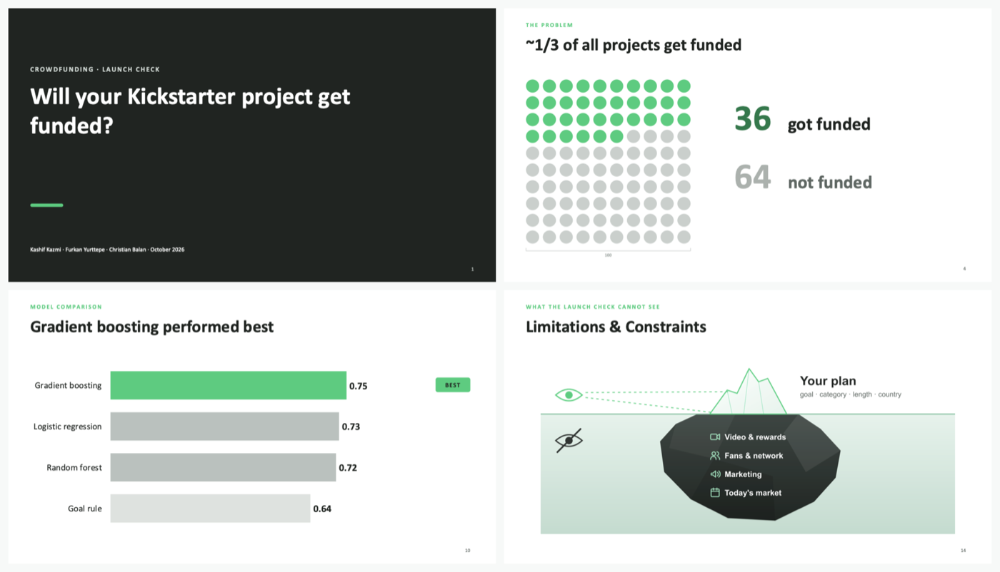

# Kickstarter Launch Check

**Will a Kickstarter project get funded? An honest chance, before launch.**

Kickstarter is all or nothing: miss the goal and you get nothing. Only about **1 in 3** projects gets funded (36 of 100). This project studies **372,293** finished projects (2009 to early 2018) and builds the **Launch Check**: a creator enters the campaign plan and gets a calibrated chance of funding, using only what is known before launch day.

**Live client deck (animated, 16 slides):** https://crsbln.github.io/ds-ml-slides/ · **Presenter cheat sheet:** https://crsbln.github.io/ds-ml-slides/presenter.html



## Team

Kashif Kazmi (Project Manager), Furkan Yurttepe (Data Scientist), Christian Balan (Design Thinker). All three of us are AIPM (AI Project Management, neuefische); the roles are each person's focus in this project.

## Findings

| | |
|---|---|
| **The problem** | ~1/3 of all projects get funded: 36 of 100. The other 64 get nothing |
| **Goal** | Smaller goals get funded far more often: up to $1k **49%**, over $100k **6%** |
| **Category** | Arts beat tech: Dance **62%**, Technology **20%**. Why tech struggles: goals too high (typical funded tech goal $10,000, not funded $20,200) |
| **Length** | The 30-day default and 60 days do worst: 30 days **32%** (29 days 46%, 31 days 50%), 60 days **19%** (59 days 24%, 61 days 38%). A sign of planning, not a magic number |
| **The trap** | Money pledged and backers are only known when a campaign ends. With them a model is right 99.7% of the time and useless on launch day, so we removed them |
| **Model comparison** | How often it picks the funded campaign out of a pair (ROC-AUC, 5-fold cross-validation): **gradient boosting 0.75**, logistic regression 0.73, random forest 0.72, simple goal rule 0.64 |
| **Final test** (74,459 unseen projects) | ROC-AUC **0.754** · F1 **0.619** vs **0.524** for the goal rule · Brier 0.189 |
| **Honest chances** | When we predict 35%, 35% get funded; predicted and real rates match within about 1 point in every group (only the smallest, 18 projects at 91%, is 3 points off) |
| **What it looks at** | Category and funding goal drive the prediction, then campaign length; title, country and launch date matter only a little |
| **Over time** | Trained before 2016, tested from 2016: ROC-AUC 0.757, but rates drift, so recalibrate before real use |

**Recommendations for creators:** set a realistic goal · pick your end date on purpose (not 30, not 60 days) · know your category (in tough ones, build an audience first). Patterns from past campaigns, not guarantees.

## The presentations

| Deck | For | Files |
|---|---|---|
| **Client** · 16 slides | Non-technical audience: the problem, three findings, how we built and checked it, the Launch Check, limits, recommendations | [Live, animated](https://crsbln.github.io/ds-ml-slides/) · [PowerPoint](presentations/client/Kickstarter_Launch_Check_Client.pptx) · [PDF](presentations/client/Kickstarter_Launch_Check_Client.pdf) |
| **Technical** · 25 slides | Data scientists and reviewers: cleaning, leakage, EDA, model choice, calibration, error analysis, limits | [PowerPoint](presentations/technical/Kickstarter_Success_Technical.pptx) · [PDF](presentations/technical/Kickstarter_Success_Technical.pdf) |
| **Presenter cheat sheet** | What to say on every client slide, plus every detail kept off the slides | [Live](https://crsbln.github.io/ds-ml-slides/presenter.html) · [Markdown](presentations/PRESENTER_CHEATSHEET.md) |

The client slides, in order: 1 cover · 2 team · 3 approach · 4 ~1/3 get funded · 5 goal · 6 category · 7 30 vs 60 days · 8 the trap: data from the future · 9 how we built it (clean · remove future data · 80% to train · 20% for the test · pick the best model) · 10 model comparison · 11 when we predict 35%, 35% get funded · 12 what the model looks at · 13 the Launch Check example · 14 limitations & constraints · 15 insights & recommendations · 16 thank you. Details: [presentations/README.md](presentations/README.md).

The PowerPoint decks are native: every chart is editable (right-click → *Edit Data*) and every slide has speaker notes (*Slide Show → Use Presenter View*). Both are generated from one numbers file, [`reports/results.json`](reports/results.json); the client deck's speaker notes and the cheat sheet come from one script, [`presentations/build/script.json`](presentations/build/script.json).

## Run it locally

You need [uv](https://docs.astral.sh/uv/getting-started/installation/) (it installs Python 3.13 for you). For rebuilding the decks you also need [Node.js](https://nodejs.org/) 18 or newer. Works on Windows, macOS and Linux.

```bash
git clone https://github.com/crsbln/ds-ml-project-template.git
cd ds-ml-project-template
uv sync                                  # 1. install everything
```

**Try the Launch Check right away** (the trained model is included):

```bash
uv run kickstarter-check --category "Tabletop Games" --goal 10000 --days 30 --launch 2026-03-03 --name "Dungeon Delvers: A Cooperative Game"
```

```text
  KICKSTARTER LAUNCH CHECK
  Tabletop Games | US | goal $10,000 | 30 days

  Chance of funding:  51%   (average project: 36%)
  [###############...............]  ABOVE AVERAGE
```

Options: `--country GB`, `--launch` (default: today), `--name` (the title), and `--list` to see all 159 categories.

> Small details like the weekday or the title length can move the estimate by several points (without `--launch` and `--name` the same game gets 33%). The model learned habits of past creators, not levers: read the number as a starting point, never as "change X to raise your chance".

**Reproduce the whole analysis:**

```bash
uv run kickstarter-download              # 2. get the Kaggle data into data/
uv run kickstarter-train                 # 3. clean, train, evaluate (a few minutes)
cd presentations/build
npm install && npm run build             # 4. rebuild both decks and the cheat sheet from the new numbers
```

If the automatic download fails, download [Kickstarter Projects](https://www.kaggle.com/datasets/kemical/kickstarter-projects) by hand and put `ks-projects-201801.csv` into `data/`.

The full, explained analysis is the notebook [`notebooks/01_kickstarter_eda_and_modeling.ipynb`](notebooks/01_kickstarter_eda_and_modeling.ipynb): open the folder in VS Code (`code .`), pick the `.venv` kernel, **Run All**.

**Tests** run on a small synthetic dataset, no download needed: `uv run pytest`. On macOS and Linux, the [`Makefile`](Makefile) has shortcuts: `make setup`, `make train`, `make slides`, `make test`.

## Use the model in Python

```python
import joblib
from kickstarter import project_features

model = joblib.load("models/kickstarter_success_model.joblib")
plan = project_features("Tabletop Games", goal_usd=10_000, duration_days=30, country="US")
print(model.predict_proba(plan)[0, 1])   # calibrated chance of funding
```

The saved model needs scikit-learn 1.9.0 (pinned in `pyproject.toml`).

## What is where

| Path | Contents |
|---|---|
| `notebooks/01_kickstarter_eda_and_modeling.ipynb` | The full analysis with all outputs: cleaning, EDA, baseline, three models, tuning, calibration, time check, error analysis |
| `src/kickstarter/` | The same pipeline as a package: `data.py` (cleaning, features), `model.py`, `train.py`, `check.py` (Launch Check), `download.py` |
| `reports/results.json` | Every number the decks show. Shipped with the notebook's values; `kickstarter-train` regenerates it |
| `models/` | The trained final model (scikit-learn 1.9.0) |
| `presentations/` | Client (16 slides) and technical (25 slides) decks as `.pptx` + `.pdf`, the presenter cheat sheet, and their generator in `presentations/build/` |
| `tests/` | Pipeline tests on synthetic data |
| `docs/` | [Plain-language summary](docs/SUMMARY.md), [ML explained](docs/ML_EXPLAINED.md), [three independent reviews](docs/reviews/), [Turkish versions](docs/tr/), the [course brief](docs/course/01_assignment.md) |
| `notebooks/reference/` | An [alternative approach](notebooks/reference/alt_approach_excluding_canceled.ipynb) (drops canceled projects: 331,675 projects, 40% funded, same patterns) and the course's coffee example |

## Important limits

- The model finds **patterns, not causes**. It shows a starting chance; it does not tell anyone what to change.
- It cannot see the video, the rewards, the creator's fans and network, or the marketing.
- The data ends in early 2018: today's market may look different, so recalibrate before real use.

## Credits

Built from the neuefische Data Science bootcamp [ML project template](https://github.com/neuefische/ds-ml-project-template). Data: [Kickstarter Projects](https://www.kaggle.com/datasets/kemical/kickstarter-projects) (Kaggle user kemical) (not redistributed here). Code under the MIT license, see [LICENSE](LICENSE).
